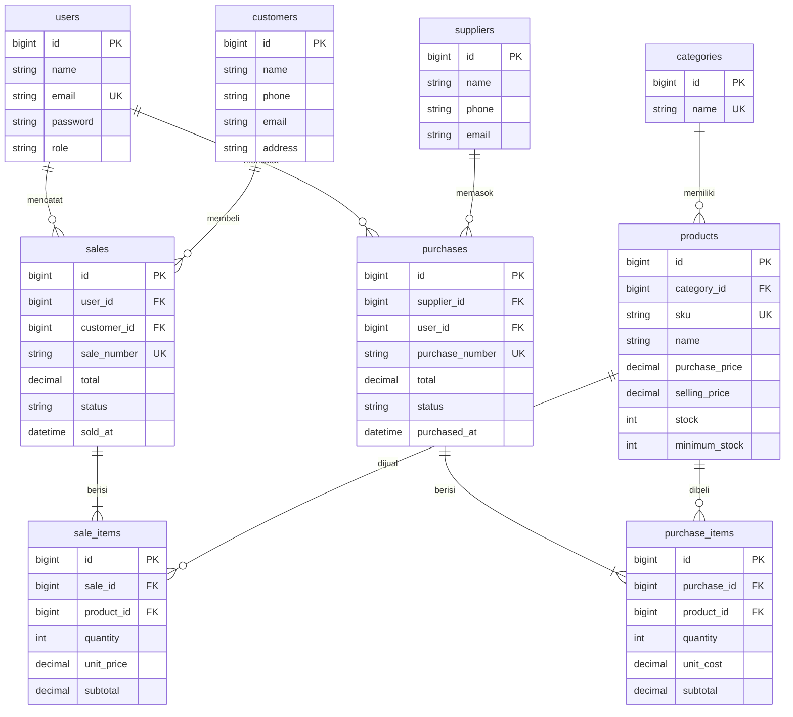

# Sweet Glaze - Inventory & Sales Management System

Aplikasi Laravel untuk mengelola produk, pemasok, pembelian stok (stock-in), dan
penjualan, dengan stok yang berubah otomatis dan akses berbasis role (Admin/Owner
dan Staff). Dibuat untuk UTS Web Programming 2 (Integrated Laravel Project).

## 1. Project overview

Usaha donat dan minuman skala kecil dengan beberapa staf. Sistem ini menjaga:

- stok selalu sesuai dengan transaksi pembelian dan penjualan,
- produk yang habis tidak dapat dijual (penjualan ditolak dengan pesan jelas),
- riwayat transaksi dapat ditelusuri (nomor, waktu, pencatat),
- hak akses berbeda untuk Admin/Owner dan Staff, dijaga di server.

## 2. Requirements

- PHP 8.0+ dan Composer
- MySQL / MariaDB (XAMPP sudah cukup)
- Node.js hanya jika ingin memakai `npm`; tampilan memakai CSS statis di `public/css`
- Laravel 8

## 3. Installation

```bash
git clone <repository-url>
cd inventory-laravel

composer install
cp .env.example .env
php artisan key:generate
```

## 4. Environment setup

Buat database kosong (misalnya `inventory_laravel`), lalu isi `.env`:

```
DB_CONNECTION=mysql
DB_HOST=127.0.0.1
DB_PORT=3306
DB_DATABASE=inventory_laravel
DB_USERNAME=root
DB_PASSWORD=
```

Kredensial hanya di `.env`. Jangan commit `.env`; commit `.env.example` saja.

## 5. Migration & seeding

```bash
php artisan migrate:fresh --seed
php artisan serve
```

Buka http://127.0.0.1:8000

> `migrate:fresh` menghapus seluruh tabel lama lalu membuat ulang dari migration.
> Cadangkan data lama bila diperlukan.

## 6. Demo account

| Role         | Email                    | Kata sandi |
|--------------|--------------------------|------------|
| Admin/Owner  | admin@sweetglaze.test    | password   |
| Staff        | staff@sweetglaze.test    | password   |

Akun ini hanya data demo, bukan kredensial asli.

## 7. Features

| Modul | Admin/Owner | Staff |
|-------|-------------|-------|
| Login, logout, password hashing, protected routes | ya | ya |
| Dashboard (total produk, penjualan hari/bulan ini, jumlah transaksi, stok rendah) | semua data | data miliknya |
| Produk: lihat, cari SKU/nama, filter kategori, detail | ya | ya (hanya lihat) |
| Produk, kategori, pemasok: tambah, ubah, hapus | ya | tidak |
| Pelanggan: tambah, ubah, cari, lihat riwayat belanja | ya | ya |
| Pelanggan: hapus (ditolak bila sudah punya penjualan) | ya | tidak |
| Penjualan dapat dikaitkan dengan pelanggan (opsional) | ya | ya |
| Daftar stok rendah | ya | ya |
| Pembelian (stock-in) dengan banyak item | ya | ya |
| Penjualan dengan banyak item | ya | ya |
| Filter nomor, status, rentang tanggal + pagination | ya | ya |
| Batalkan transaksi (stok dipulihkan konsisten) | ya | tidak |
| Kelola pengguna dan role | ya | tidak |

### Business rules yang diterapkan

- SKU unik (validasi Laravel + unique index database).
- Jumlah transaksi harus > 0; harga tidak boleh negatif.
- Penjualan tidak boleh melebihi stok; stok berubah hanya setelah transaksi sukses.
- Harga diambil dari database dan total dihitung di server, bukan dari input browser.
- Header, item, dan perubahan stok disimpan dalam satu `DB::transaction`; produk
  dikunci dengan `lockForUpdate()` untuk mencegah overselling pada transaksi bersamaan.
- Jika satu item gagal, seluruh transaksi di-rollback.
- Transaksi selesai tidak diedit; hanya dapat dibatalkan Admin. Pembatalan penjualan
  menambah stok kembali; pembatalan pembelian ditolak bila stok sudah terpakai.
- Produk yang sudah dipakai transaksi tidak dapat dihapus (larangan hapus).
- Staff hanya dapat melihat transaksi miliknya sendiri.

### Struktur kode

```
routes/web.php                    named routes + resource routes + middleware can:
app/Providers/AuthServiceProvider Gate: manage-master, manage-users, cancel-transaction, ...
app/Http/Controllers/*            controller tipis, tidak ada logika transaksi di Blade
app/Http/Requests/*               Form Request (validasi server-side, pesan Indonesia)
app/Services/SaleService.php      logika penjualan atomik
app/Services/PurchaseService.php  logika pembelian atomik
app/Models/*                      relasi Eloquent + fillable (mass-assignment protection)
database/migrations, seeders      skema lengkap + data demo realistis
resources/views                   layout reusable + halaman Blade
public/css/sweetglaze.css         tema tampilan
tests/Feature                     test scenario
```

## ERD



### Relasi Eloquent

- `Category hasMany Product`, `Product belongsTo Category`
- `Supplier hasMany Purchase`, `Purchase belongsTo Supplier`
- `Purchase hasMany PurchaseItem`, `PurchaseItem belongsTo Purchase` dan `Product`
- `Customer hasMany Sale`, `Sale belongsTo Customer` (opsional)
- `User hasMany Sale`, `Sale belongsTo User`
- `Sale hasMany SaleItem`, `SaleItem belongsTo Sale` dan `Product`
- `Product hasMany SaleItem` dan `PurchaseItem`

Foreign key berada di tabel detail (child) karena satu header memiliki banyak baris
detail; sisi `belongsTo` adalah pemilik kolom foreign key.

## Testing

Test memakai SQLite in-memory (lihat `phpunit.xml`), sehingga database MySQL Anda
tidak tersentuh. Pastikan ekstensi `pdo_sqlite` aktif di `php.ini`.

```bash
php artisan test
```

| Skenario | Test |
|----------|------|
| Guest tidak dapat membuka dashboard; password salah ditolak | `AuthenticationTest` |
| SKU duplikat dan harga negatif ditolak | `ProductTest` |
| Pembelian sukses menambah stok | `TransactionTest::test_successful_purchase_increases_stock` |
| Penjualan sukses mengurangi stok; total dihitung server | `TransactionTest::test_successful_sale_...` |
| Stok tidak cukup ditolak tanpa perubahan data | `TransactionTest::test_sale_with_insufficient_stock_...` |
| Satu item gagal, seluruh transaksi rollback | `TransactionTest::test_failure_on_one_item_...` |
| Staff tidak dapat mengakses fungsi Admin lewat URL | `AuthorizationTest` |
| Filter dan pagination menghasilkan data yang sesuai | `ProductTest`, `TransactionTest` |

## 8. Known limitations

- Tidak ada payment gateway, multi-gudang, multi-currency, atau akuntansi penuh.
- Satu mata uang (Rupiah) dan satu gudang.
- Font dimuat dari Google Fonts; tanpa internet tampilan memakai font sistem.
